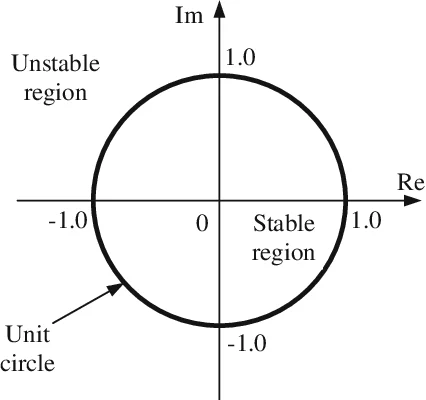
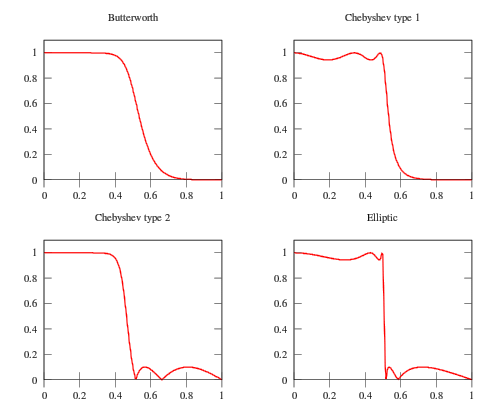
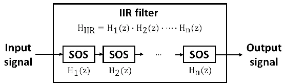
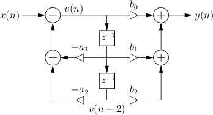
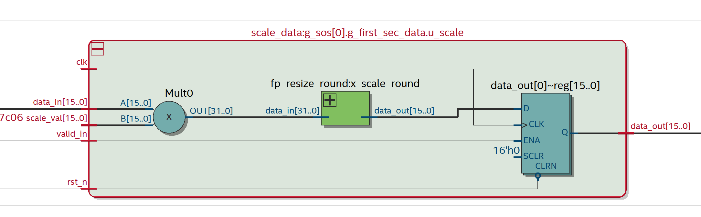
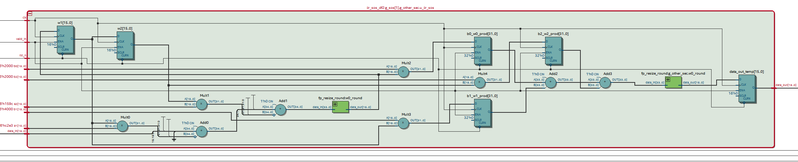
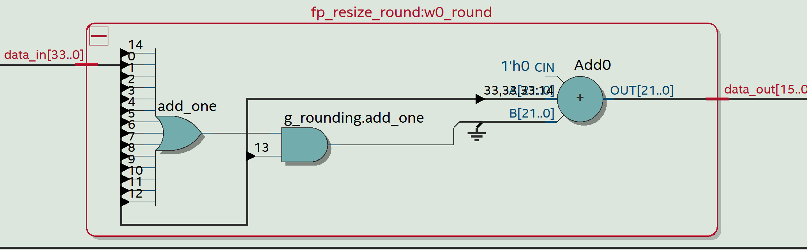
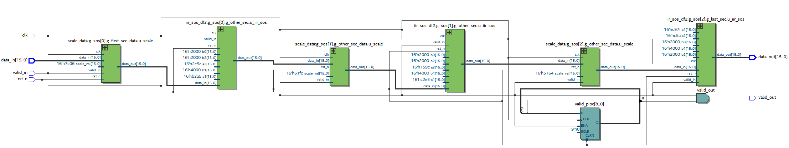
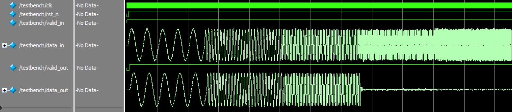
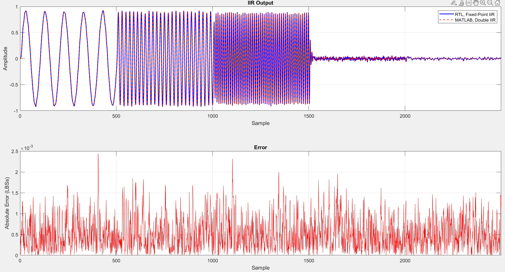

# Direct-Form II Second-Order Sections IIR <!-- omit in toc -->
A parameterizable Direct Form II Second-Order Sections Infinite Impulse Response (IIR) filter implemented in SystemVerilog with verification using a MATLAB scripts and SystemVerilog Testbench.

Clone the Repo:
```
git clone https://github.com/pletnevAE/iir_df2_sos.git
```

## Contents <!-- omit in toc -->
- [Overview](#overview)
- [Theoretical basis](#theoretical-basis)
  - [Mathematical description](#mathematical-description)
  - [Stability analysis and phase characteristics](#stability-analysis-and-phase-characteristics)
  - [Canonical forms and cascaded implementation (SOS)](#canonical-forms-and-cascaded-implementation-sos)
  - [Hardware implementation and finite word length effects](#hardware-implementation-and-finite-word-length-effects)
- [Architecture](#architecture)
- [Interface](#interface)
  - [Parameters](#parameters)
  - [Signals](#signals)
- [Utilization](#utilization)
- [Simulation](#simulation)
- [Building the project out-of-the-box](#building-the-project-out-of-the-box)

## Overview
The module is designed for high-speed digital filtering within FPGA-based digital signal processing (DSP) chains. It efficiently implements high-order IIR filters by cascading Second-Order Sections (SOS), which minimizes quantization noise and prevents stability issues common in high-order fixed-point IIR implementations.

Typical applications:
+ Software Defined Radio (SDR);
+ audio and video signal processing;
+ digital communications;
+ medical equipment;
+ radiolocation and navigation;
+ industry.

## Theoretical basis
Infinite Impulse Response (IIR) digital filters represent a class of discrete-time linear time-invariant (LTI) systems containing feedback loops. The presence of feedback results in an infinite duration of the system's response to a unit impulse, fundamentally distinguishing them from FIR (Finite Impulse Response) filters.

### Mathematical Description
The time domain of an IIR filter is described by a linear difference equation with constant coefficients:

$$y[n] = \sum_{k = 0}^{M}{b_k \cdot x[n - k]} - \sum_{k = 1}^{N}{a_k \cdot y[n - k]}$$

where $x[n]$ is the input signal, $y[n]$ is the output signal, $b_k$ are the feedforward (numerator) coefficients, and $a_k$ are the feedback (denominator) coefficients. The minus sign before the second sum is a standard academic convention, although practical implementations often use addition with inverted coefficients.

Applying the $Z$-transform to both sides of the difference equation yields the system's transfer function in the $Z$-domain:

$$H(z) = \frac{Y(z)}{X(z)} = \frac{\sum_{k = 0}^{M}{b_k \cdot z^{-k}}}{1 + \sum_{k = 1}^{N}{a_k \cdot z^{-k}}}$$

This rational function fully defines the frequency characteristics of the filter. The roots of the numerator polynomial are called zeros, and the roots of the denominator polynomial are called poles.

### Stability analysis and phase characteristics
+ **Stability**: Unlike FIR filters, which are unconditionally stable, IIR filters are potentially unstable. A necessary and sufficient condition for the stability of a system is that all poles of the transfer function lie strictly inside the unit circle on the complex $Z$-plane ($|p_k| < 1$).

<p align="center">
  
</p>

+ **Phase characteristics**: IIR filters fundamentally cannot possess a strictly linear phase response (with the exception of specialized filtering techniques, such as forward-backward filtering). This leads to non-uniform group delay and dispersion distortion of wideband signals.

<p align="center">
  
</p>

### Canonical forms and cascaded implementation (SOS)
Implementing high-order IIR filters as a single polynomial (Direct Form) is associated with critical sensitivity of the roots (poles) to coefficient quantization errors. When transitioning to hardware architectures, the transfer function is factored into a cascade of biquadratic Second-Order Sections (SOS):

$$H(z) = g \cdot \prod_{k = 1}^{k} \frac{b_{0k} + b_{1k} \cdot z^{-1} + b_{2k} \cdot z^{-2}}{1 + a_{1k} \cdot z^{-1} + a_{2k} \cdot z^{-2}}$$

where $g$ is the overall gain coefficient.

<p align="center">
  
</p>

To implement each section (biquad) in the RTL logic, **Direct-Form II (DF-II)** is most commonly used. This form is canonical in terms of the number of delay elements:
+ **State node**: $v[n] = x[n] - a_1 \cdot v[n - 1] - a_2 \cdot v[n - 2]$
+ **Output equation**: $y[n] = b_0 \cdot v[n] + b_1 \cdot v[n - 1] + b_2 \cdot v[n - 2]$

<p align="center">
  
</p>

An alternative is the **Direct-Form II Transposed**, which is often preferred in pipelined hardware architectures because it redistributes critical paths and allows for easier insertion of pipeline registers into adder trees.

### Hardware implementation and finite word length effects
Transitioning from mathematical models to the physical layer using fixed-point arithmetic introduces several nonlinear effects requiring rigorous analysis:
+ **Limit cycles**: in the absence of an input signal, the nonlinearity of truncation (or rounding) in the feedback loop can cause the filter to self-oscillate, producing low-amplitude periodic oscillations.
+ **Overflow**: exceeding the bit width in feedback adders causes a "wrap-around" effect, leading to high-amplitude oscillations. To combat this, saturation arithmetic and scaling of the computation graph's input nodes.
+ **Quantization noise**: limiting the coefficient bit width shifts the poles from their ideal positions, which degrades the amplitude-frequency response (e.g., reduces stopband attenuation) and decreases the stability margin.

## Architecture
The architecture consists of a cascaded chain of `N_SEC` second-order sections:
1. **Scaling stage**: inter-section scaling is handled by the **scale_data.sv** module, which multiplies the incoming data by a scaling factor `scale_val` to prevent internal overflow before it enters a section.

<p align="center">
  
</p>

2. **Feedback loop**: the **iir_sos_df2.sv** module computes the denominator accumulator by subtracting the feedback product from the input data.

<p align="center">
  
</p>

3. **State delay line**: the internal states are stored in registers updated on every valid clock cycle.
4. **Feedforward path**: the numerator products are summed in the feedforward accumulator. Synthesis attributes (`multstyle = "dsp"`) enforce the mapping of all multipliers to dedicated DSP blocks.
5. **Rounding and resizing**: a dedicated **fp_resize_round.sv** module aligns fractional lengths and safely resizes data buses. It supports truncation, nearest, and convergent rounding modes, and includes optional saturation logic to clamp values and prevent wrap-around overflow.

<p align="center">
  
</p>

6. **Output pipeline**: valid data propagates through the pipeline with a total latency of $Latency = 3 \times N_{SEC}$ clock cycles.

<p align="center">
  
</p>

Key implementation features:
+ cascade of `N_SEC` Direct-Form II second-order sections;
+ asynchronous Active-Low reset (`rst_n`);
+ lowpass, highpass, bandpass and bandstop filters; Butterworth, Chebyshev I, Chebyshev II and elliptic approximations;
+ wrap-around arithmetic without saturation logic;
+ optimal bit depths of multipliers and accumulators when calculating via a MATLAB script (**IIR_calc.m**);
+ synthesis attributes (`multstyle = "dsp"`) map the multipliers to dedicated DSP blocks;
+ latency of $3 \times N_{SEC}$ samples per section;
+ pipelining of the feedforward path.

## Interface
### Parameters
Parameter values are passed to the top module using a **iir_params.vh** header file.

| Parameter | Constant in **iir_params.vh** | Description |
|:--:|:--:|:--:|
| `N_SEC` | `ORDER / 2` | Number of sections |
| `IN_WL` | `INPUT_WL` | Input word length |
| `IN_FL` | `INPUT_FL` | Input fraction length |
| `OUT_WL` | `OUTPUT_WL` | Output word length |
| `OUT_FL` | `OUTPUT_FL` | Output fraction length |
| `SEC_IN_WL` | `SEC_INPUT_WL` | Section input word length |
| `SEC_IN_FL` | `SEC_INPUT_FL` | Section input fraction length |
| `SEC_OUT_WL` | `SEC_OUTPUT_WL` | Section output word length |
| `SEC_OUT_FL` | `SEC_OUTPUT_FL` | Section output fraction length |
| `STATE_WL` | `STATE_IIR_WL` | State word length |
| `STATE_FL` | `STATE_IIR_FL` | State fraction length |
| `COEFF_WL` | `COEFFICIENT_WL` | Coefficients word length |
| `COEFF_NUM_FL` | `COEFFICIENT_NUM_FL` | Numerator fraction length |
| `COEFF_DENOM_FL` | `COEFFICIENT_DENOM_FL` | Denominator fraction length |
| `SCALE_FL` | `COEFFICIENT_SCALE_FL` | Scale values fraction length |
| `MULT_WL` | `PROD_WL` | Product word length |
| `MULT_NUM_FL` | `PROD_NUM_FL` | Product Numerator fraction length |
| `MULT_DENOM_FL` | `PROD_DENOM_FL` | Product Denominator fraction length |
| `ACC_WL` | `ACCUM_WL` | Accumulator word length |
| `ACC_NUM_FL` | `ACCUM_NUM_FL` | Accumulator Numerator fraction length |
| `ACC_DENOM_FL` | `ACCUM_DENOM_FL` | Accumlulator Denominator fraction length |
| `OUT_MULT` | `OUT_MULTIPLIER` | Activation of the output multiplier |
| `ROUND_MODE` | - (default 2) | Rounding method |

### Signals
| Port | Direction | Width | Description |
|:--:|:--:|:--:|:--:|
| `clk` | Input | 1 | Clock signal |
| `rst_n` | Input | 1 | Asynchronous Active-Low Reset |
| `valid_in` | Input | 1 | Input data valid |
| `data_in` | Input | `IN_WL` | Input data |
| `valid_out` | Output | 1 | Output data valid |
| `data_out` | Output | `OUT_WL` | Output data |

## Utilization
The project was synthesized for the 10M50DAF484C6GES FPGA on the DE10-Lite board using Quartus 22.1 Standard Edition. The data were obtained under the following parameters: `IN_WL = 16`, `IN_FL = 15`, `H_WL = 16`, `OUT_WL = 16`, `SEC_IN_WL = 16`, `SEC_OUT_WL = 16`, `STATE_WL = 16`, `STATE_FL = 15`.
| FPGA | Option | `N_SEC` | LUT | FF | DSP | Fmax, MHz | Hold Slack, ns | Setup Slack, ns |
|:--:|:--:|:--:|:--:|:--:|:--:|:--:|:--:|:--:|
| 10M50DAF484C6GES | **DF2 SOS** | 3 | 577 | 332 | 24 | 58.35 | 0.364 | 2.862 |
| 10M50DAF484C6GES | DF2T SLA | 3 | 1070 | 578 | 42 | 80.35 | 0.362 | 7.554 |
| 10M50DAF484C6GES | **DF2 SOS** | 5 | 946 | 544 | 40 | 58.18 | 0.362 | 2.811 |
| 10M50DAF484C6GES | DF2T SLA | 5 | 1632 | 807 | 70 | 79.99 | 0.362 | 7.498 |
| 10M50DAF484C6GES | **DF2 SOS** | 6 | 1143 | 650 | 48 | 58.02 | 0.362 | 2.766 |
| 10M50DAF484C6GES | DF2T SLA | 6 | 2037 | 1074 | 84 | 75.77 | 0.361 | 6.803 |
| 10M50DAF484C6GES | **DF2 SOS** | 10 | 1913 | 1069 | 80 | 56.90 | 0.362 | 2.425 |
| 10M50DAF484C6GES | DF2T SLA | 10 | 3335 | 1686 | 140 | 78.43 | 0.362 | 7.250 |

## Simulation
Before runnung simulation, a MATLAB script **IIR_calc_auto.m** is used to generate the stimulus signal, the **iir_params.vh** header file and the files with coefficients (**b_coeffs.txt**, **a_coeffs.txt**, **scale_coeffs.txt**). To call the script from outside the project's out-of-the-box build script, use the following format:

```
IIR_calc_auto('<build_path>', {'-F_CLK <value> -F_S <value> -FILTER_TYPE <string> -FILTER_APPROX <string> -F_PASS <value> -F_STOP <value> -F_PASS1 <value> -F_PASS2 <value> -F_STOP1 <value> -F_STOP2 <value> -A_PASS <value> -A_STOP <value> -A_PASS1 <value> -A_PASS2 <value> -A_STOP1 <value> -A_STOP2 <value> -IN_WL <value> -IN_FL <value> -H_WL <value> -OUT_WL <value> -SEC_IN_WL <value> -SEC_OUT_WL <value>  -STATE_WL <value> -STATE_FL <value>'})
```

The script performs the following steps:
1. designs the reference SOS filter (**IIR_Calculation.m**);
2. converts the coefficients to fixed-point and calculates all word/fraction lengths;
3. builds a bit-accurate fixed-point model in MATLAB and plots the magnitude responses *Double Precision* and *Fixed-Point*, which are saved in .png format to the build directory (**MagResponse.png**);
4. generates the stimulus: five segments of 500 samples each, sine waves with the amplitude 0.9 and the frequencies $F_{pass} / 10$, $F_{pass} / 2$, $F_{pass}$, 2 F_{pass}$ and $2.5 F_{pass}$, with added Gaussian noise (standard deviation 0.03);
5. writes the coefficients, the parameter header, thi stimulus and a **params.mat** file with the parameters for the analysis script.

After placing the generated files into the project root folder, it is necessary to set the required parameters in the SystemVerilog **testbench.sv**. By default, parameters are taken from the **iir_params.vh**.

| Parameter | Default Value | Description |
|:--:|:--:|:--:|
| `N_SEC` | - | Number of second-order sections |
| `IN_WL` | - | Input word length |
| `IN_FL` | - | Input fraction length |
| `OUT_WL` | - | Output word length |
| `OUT_FL` | - | Output fraction length |
| `SEC_IN_WL` | - | Section input word length |
| `SEC_IN_FL` | - | Section input fraction length |
| `SEC_OUT_WL` | - | Section output word length |
| `SEC_OUT_FL` | - | Section output fraction length |
| `STATE_WL` | - | State word length |
| `STATE_FL` | - | State fraction length |
| `COEFF_WL` | - | Coefficients word length |
| `COEFF_NUM_FL` | - | Numerator fraction length |
| `COEFF_DENOM_FL` | - | Denominator fraction length |
| `SCALE_FL` | - | Scale values fraction length |
| `MULT_WL` | - | Product word length |
| `MULT_NUM_FL` | - | Product Numerator fraction length |
| `MULT_DENOM_FL` | - | Product Denominator fraction length |
| `ACC_WL` | - | Accumulator word length |
| `ACC_NUM_FL` | - | Accumulator Numerator fraction length |
| `ACC_DENOM_FL` | - | Accumlulator Denominator fraction length |
| `OUT_MULT` | - | Activation of the output multiplier |
| `ROUND_MODE` | 2 | Rounding method (default - convergent) |
| `CLK_PERIOD` | - | Clock period in ns |
| `CLK_ENABLE_DIV` | - | Clock division factor for determining the clock enable frequency |
| `RESET_CYCLES` | 10 | Number of clock cycles before reset release |
| `NUM_SAMPLES` | - | Number of stimulus samples |

The testbench reads the samples from **stimulus.txt**, applies one sample on every `valid_in` strobe and writes every output sample with `valid_in = 1` to **output_iir.txt**. The simulation finishes when the number of written samples is equal to the number of the stimulus samples.

<p align="center">
  
</p>

A MATLAB script **IIR_analyze_auto.m** is used to analyze the obtained results. To call the script from outside the project's out-of-the-box build script, use the following format:

```
IIR_analyze_auto('<build_path>')
```

It reads the files generated during the simulation, calculates the original IIR filter with double-type coefficients based on the given characteristics, and determines the absolute and RMS error and $SQNR$ of the RTL output relative to it.

Upon completion, the script plots the RTL IIR output signal alongside the reference IIR output, as well as the absolute errors.

<p align="center">
  
</p>

The calculated values for these parameters are also displayed in the console:

```
==================== IIR REPORT ====================
Filter Type                        : lowpass
Design Method                      : butter
Filter Order                       : 20
Input Word length                  : 16
Input Fraction length              : 15
Output Word length                 : 16
Output Fraction length             : 7
Coeff Word length                  : 16
Coeff Num. Fraction length         : 13
Coeff Denom. Fraction length       : 14
Scale Values Fraction length       : 18
Section Input Word length          : 20
Section Input Fraction length      : 13
Section Output Word length         : 20
Section Output Fraction length     : 11
State Word length                  : 20
State Fraction length              : 16
Product Word length                : 36
Product Num. Fraction length       : 29
Product Denom. Fraction length     : 30
Accum. Word length                 : 38
Accum. Num. Fraction length        : 29
Accum. Denom. Fraction length      : 30

----------------------------------------------------
Maximum Absolute Error             : 5.101178e-03
RMS Error                          : 2.332093e-03
Actual Measured SQNR               : 46.48 dB

====================================================
```

## Building the project out-of-the-box
Scripts **run_build.bat**, **build.tcl**, **timing.tcl** and **sim.tcl** are implemented for building the project out-of-the-box. The script also starts the generation of the necessary files (**IIR_calc_auto.m**), simulation in Modelsim and comparison of the module outputs with the reference model (**IIR_analyze_auto.m**). For the scripts to work, the path to the **bin64** folder within the Quartus root directory must be included in the `PATH` environment variable in Windows. The MATLAB scripts require the DSP System Toolbox and the Fixed-Point Designer.

To run the script, you need to enter the following in the command line from the directory **tcl**:
```
run_build.bat <build_path> -F_CLK <value> -F_S <value> -FILTER_TYPE <string> -FILTER_APPROX <string> -F_PASS <value> -F_STOP <value> -F_PASS1 <value> -F_PASS2 <value> -F_STOP1 <value> -F_STOP2 <value> -A_PASS <value> -A_STOP <value> -A_PASS1 <value> -A_PASS2 <value> -A_STOP1 <value> -A_STOP2 <value> -IN_WL <value> -IN_FL <value> -H_WL <value> -OUT_WL <value> -SEC_IN_WL <value> -SEC_OUT_WL <value> -STATE_WL <value> -STATE_FL <value>
```

To get help on the script, you need to enter the following in the command line:
```
run_build.bat <build_path> --help
```

Setting the parameter flags is not necessary; if one of them (or all of them) is not set, the parameter will take on the default value.

| Flag | Description | Default |
|:--|:--|:--|
| `-F_CLK` | Clock frequency, Hz (must be an integer multiple of `-F_S`) | 100e6 |
| `-F_S` | Sampling frequency, Hz | 100e6 |
| `-FILTER_TYPE` | `lowpass`, `highpass`, `bandpass` or `bandstop` | lowpass |
| `-FILTER_APPROX` | `butter`, `ellip`, `cheby1` or `cheby2` | butter |
| `-F_PASS`, `-F_STOP` | Passband and stopband edges, Hz (lowpass, highpass) | 10e6, 15e6 |
| `-F_PASS1`, `-F_PASS2`, `-F_STOP1`, `-F_STOP2` | Band edges, Hz (bandpass, bandstop) | 10e6, 15e6, 7e6, 18e6 |
| `-A_PASS` | Passband ripple, dB (lowpass, highpass, bandpass) | 0.1 |
| `-A_STOP` | Stopband ripple, dB (lowpass, highpass, bandstope) | 60 |
| `-A_PASS1`, `-A_PASS2` | Passband ripple of the bandstop filter, dB | 0.1, 0.1 |
| `-A_STOP1`, `-A_STOP2` | Stopband ripple of the bandpass filter, dB | 60, 60 |
| `-IN_WL`, `-IN_FL` | Input word and fraction length | 16, 15 |
| `-OUT_WL` | Output word length | 16 |
| `-H_WL` | Coefficients word length | 16 |
| `-SEC_IN_WL`, `-SEC_OUT_WL` | Section input and output word length | 16, 16 |
| `-STATE_WL`, `-STATE_FL` | State word and fraction length | 16, 16 |

The scripts output project build information, a Compilation Report, STA results to the console and MATLAB chart.